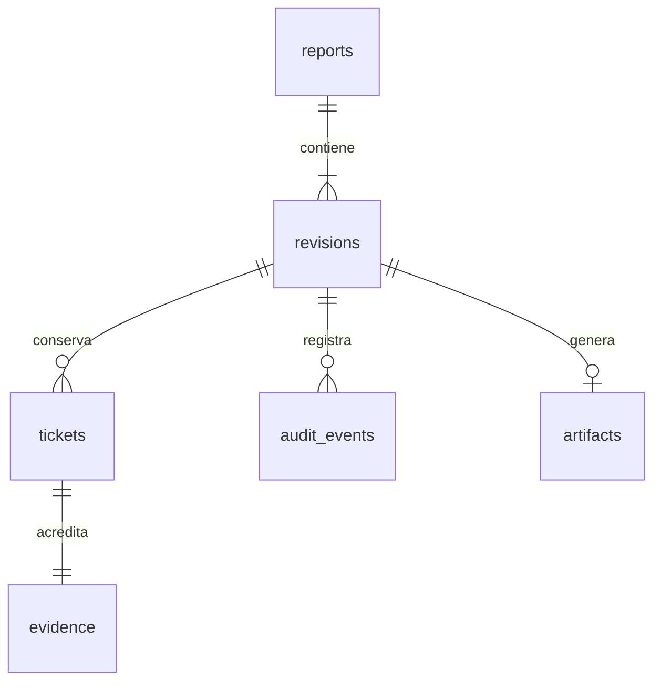

# Arquitectura de Operador · esquema local 2

La implementación mantiene una pantalla, un objetivo y una acción principal. `apps/operador` integra UI, SQLCipher, Keystore, cámara, archivos, PDF y compartir; `packages/mule_data` concentra validaciones, esquema, repositorio transaccional y codec de intercambio.

## Persistencia

El esquema ejecutable está en `packages/mule_data/lib/src/schema.dart`. La migración 1→2 añade actor y detalles de auditoría, configuración no secreta y artefactos. Las claves foráneas se habilitan en cada conexión. `settings` conserva preferencias y el identificador de una captura de cámara pendiente, nunca contraseñas.

Los borradores guardan campo, ficha y paso; la navegación espera la cola de escrituras. El cierre valida fichas completas y evidencias resueltas. Los triggers protegen revisiones cerradas, sus fichas, evidencias e identidad del reporte. La auditoría es anexada y conserva equipo, operador, acción e instante UTC del reloj local; no acredita identidad criptográfica individual.

La reapertura duplica la instantánea en una revisión con número siguiente, conservando `tickets.logical_id` e identificando cada fila con un nuevo ID. Los códigos y lecturas se almacenan como texto. La precisión admite hasta tres decimales. Al elegir una fecha ya cerrada se abre su cierre existente; no se crea silenciosamente otro reporte.

## Archivos y recuperación

Las fotos se escriben en archivos privados temporales y se finalizan antes de asociarlas a SQLite. Una sustitución conserva el archivo anterior para las revisiones que lo referencien. No se elimina automáticamente evidencia histórica. Los cierres guardan referencias al PDF exacto, paquete cifrado y hash del PDF; el reenvío reutiliza esos archivos. Un cierre cuyo proceso de generación se interrumpió puede preparar sus archivos al reabrir su vista.

El PDF muestra hasta dos conduces por página para conservar tamaño de imagen. La exportación de originales usa el selector de archivos Android y conserva el formato de la imagen. La hoja de compartir recibe PDF y `.mule` juntos. `share_started` registra la apertura local del flujo y no prueba entrega. Los eventos posteriores al empaquetado quedan en el respaldo y no reescriben el paquete original.

El respaldo incluye todas las tablas, fotos originales y adjuntos exactos. Antes de incorporar datos se autentica el contenedor y se verifican rutas, hashes y referencias. Los archivos se escriben antes de la transacción SQLite; ante un error se retiran las nuevas copias. Las filas existentes iguales se omiten; las distintas provocan cancelación transaccional. Los cursores y cierres se reconstruyen después de sus fichas y evidencias para respetar claves y triggers. Los equipos originales se conservan; el equipo restaurador usa un ID nuevo.

## Contrato de intercambio 1

`.mule` y `.mulebackup` son contenedores JSON cifrados y versionados; no contienen una copia del SQLite local ni su clave. AES-256-GCM, nonce aleatorio de 12 bytes y etiqueta de 16 bytes; PBKDF2-HMAC-SHA256 con sal aleatoria de 16 bytes y 210000 iteraciones. Los parámetros se verifican antes de derivar la clave. El contenido se comprime mediante gzip y se autentica con AAD `MuleAgent:1`.

El contenedor declara `format`, `version`, `kdf`, `iterations`, `salt`, `nonce`, `ciphertext` y `mac`; los bytes se representan en base64. El contenido declara `schema: 1`, `kind: report|backup`, fecha, registros en `tables` y archivos en `files`. Cada archivo lleva bytes originales y SHA-256. Un reporte solo incluye sus entidades de reporte, revisión, fichas, evidencias y auditoría; además identifica el PDF adjunto por ruta y hash. Un respaldo añade configuración no secreta y artefactos de todas las revisiones. El futuro receptor debe validar este contrato y no inferir entrega a partir de auditoría local.

El esquema SQLite y el contrato de intercambio se versionan por separado. Los cambios futuros de columnas exportadas requieren revisar el contrato. Clave compartida de al menos 12 caracteres, introducida y confirmada en configuración, almacenada mediante Android Keystore. SQLCipher utiliza otra clave local aleatoria de 256 bits; si falta la clave de una base existente no se genera otra que la sustituya. Copias automáticas Android deshabilitadas.

## Entrega y alcance

Ver [guía de instalación y límites](operador-v1.0.md). Administrador, cruces y exportaciones administrativas pertenecen al segundo APK. La compilación y las pruebas automatizadas se ejecutan en GitHub Actions. Se entrega una APK de desarrollo para prueba de campo; la verificación física y la firma productiva estable siguen siendo pasos de distribución.
