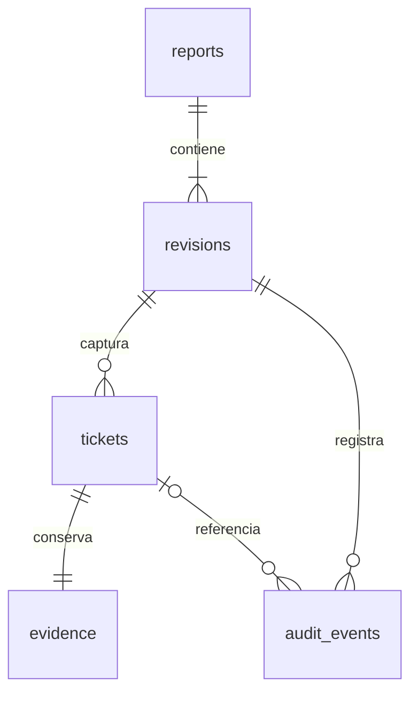

# Arquitectura de datos · inicio de Operador

Implementación inicial del plan maestro v2. El prototipo sigue siendo la referencia de diseño: una pantalla, un objetivo y una acción principal.

## Modelo implementado

El esquema ejecutable y sus restricciones están en `packages/mule_data/lib/src/schema.dart`; versión local 1. `reports` conserva fecha operativa, etapa y equipo. `revisions` identifica una versión y guarda el paso y la ficha en curso. `tickets.id` identifica la fila; `logical_id` permite conservar la identidad de una ficha al copiarla a otra revisión en una futura reapertura. Código de ficha y horómetro se conservan como texto para evitar pérdida de ceros y redondeo binario. La precisión provisional permite hasta tres decimales y debe validarse en campo.

`evidence` admite pendiente, foto u omisión con motivo, con combinaciones controladas mediante CHECK. Esta entrega solo captura omisiones expresas; no simula fotos. La cámara y el ciclo de archivos temporales están pendientes. Una evidencia pendiente impide completar y cerrar.

Claves foráneas habilitadas en cada conexión; índices por revisión; una sola revisión borrador por reporte; triggers para impedir cambios de fichas y evidencias cerradas. Auditoría técnica de inicio, edición y finalización anexada dentro de las transacciones, sin actualización ni borrado. La identificación del operador y la auditoría de cambios de cada valor se incorporarán antes del piloto. El reloj del dispositivo no prueba identidad ni entrega.

## Persistencia y recuperación

Cada cambio de campo se encola y guarda; la navegación espera la cola y vuelve a guardar el valor visible. Los valores incompletos se conservan, pero Siguiente los valida. Completar una ficha verifica todos los datos leyendo SQLite y actualiza ficha, cursor y evento en una transacción. El repositorio rechaza escrituras desde un paso obsoleto.

Al iniciar se recupera la revisión borrador con actividad más reciente del equipo. Entrada y salida son independientes. Las fichas existentes pueden corregirse sin perder sus otros campos. La fecha operativa inicial es el día local del celular; la selección explícita de fecha y la lista de jornadas pendientes están por implementar.

## Cifrado local

La app abre SQLCipher con una clave aleatoria local de 256 bits, conservada mediante `flutter_secure_storage` (Android Keystore). Si existe la base pero falta la clave, se bloquea la apertura y no se reemplaza. Las copias automáticas de Android se deshabilitan. Esta clave local no es todavía la clave compartida del intercambio. Falta validar cifrado y recuperación de claves en un Android físico; las pruebas de repositorio usan SQLite normal en el equipo de desarrollo.

## Separación del código

`packages/mule_data` contiene modelos, validaciones, esquema y repositorio, sin dependencias de widgets ni de un plugin Android concreto. `apps/operador` contiene el adaptador SQLCipher/Keystore y la interfaz Flutter. El repositorio recibe la conexión y el identificador de equipo; las pruebas usan una base temporal real. La coordinación de pantalla es inicial y se extraerá a un controlador antes de ampliar cámara, cierre y envío.

## Alcance pendiente

Cámara y galería; configuración de operador y clave compartida; confirmación de fecha; catálogo de jornadas; revisión final y cierre desde la UI; nueva revisión y reapertura; PDF; paquete cifrado versionado; importar sin duplicados; WhatsApp; historial de archivos; respaldo/restauración; Administrador; animaciones definitivas. Los estados y triggers de cierre ya se prueban en la capa de datos, pero la UI no ofrece un cierre sin sus archivos.

Los módulos de artefactos, importaciones y vínculos se incorporarán con migraciones y pruebas cuando se implemente cada capacidad. No se considera cumplida la Fase 0 completa hasta validar un recorrido con foto, PDF, paquete y receptor en Android real.

## Plan inmediato

1. Validar esta base en Android: instalación, SQLCipher, teclado, tamaño de texto, interrupción y recuperación.
2. Extraer controlador y añadir fecha operativa, operador y acceso a todos los borradores.
3. Implementar cámara/galería con originales privados, confirmación de evidencia y recuperación de archivos interrumpidos.
4. Completar revisión, cierre inmutable, PDF y paquete de intercambio; probar ambos adjuntos en WhatsApp.
5. Añadir historial, reapertura y respaldo antes del piloto con operadores.

Plan maestro v2: https://docs.google.com/document/d/19a6wKi1g6V3FK0fXGAqGsATZPMZln6YXK2bkbEARnmE/edit
